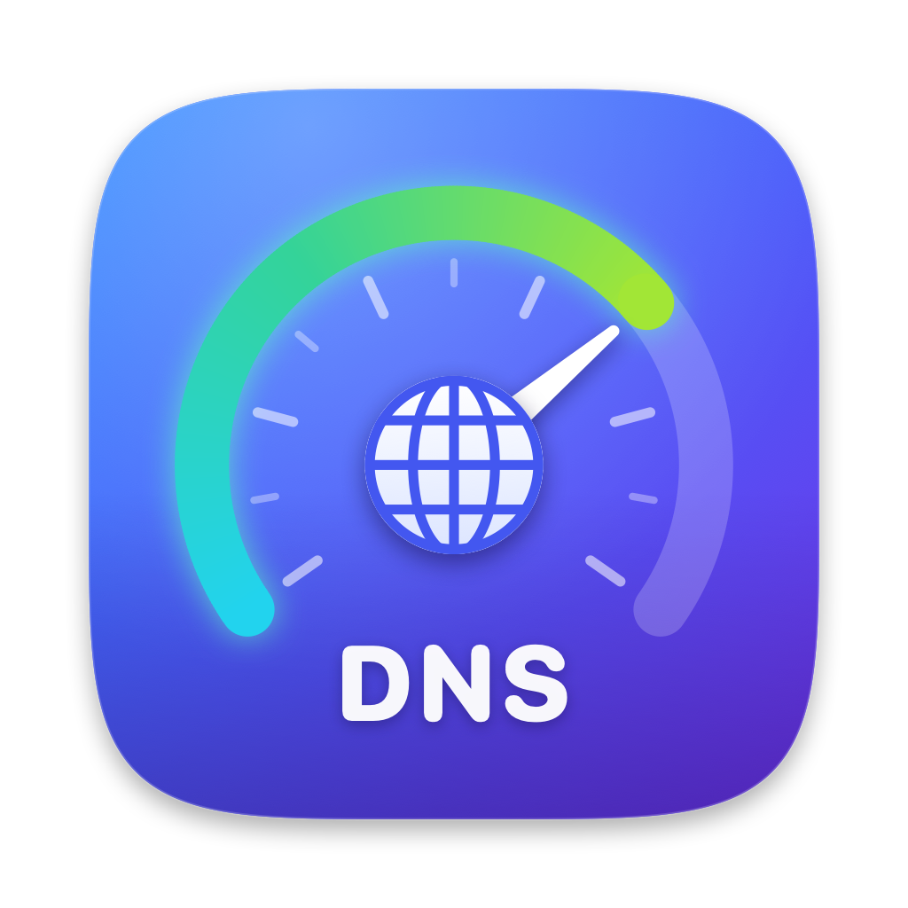
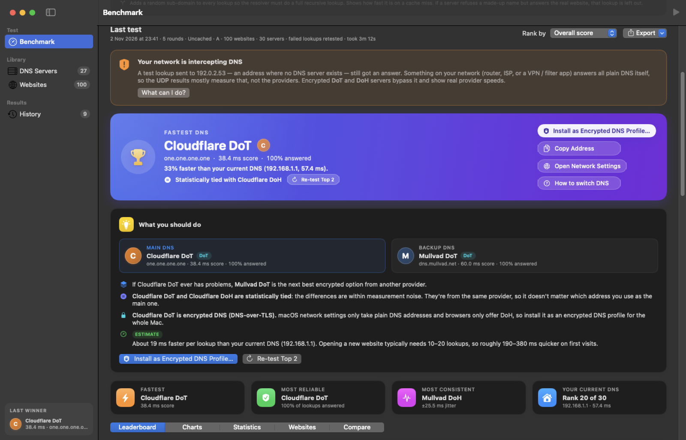
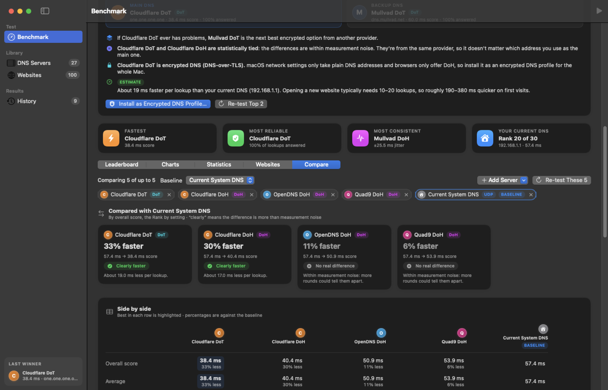
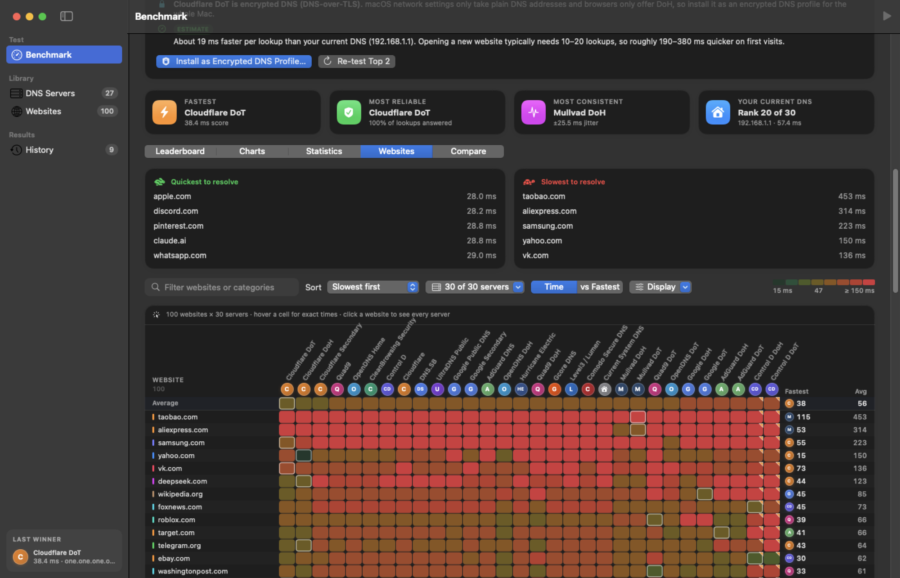
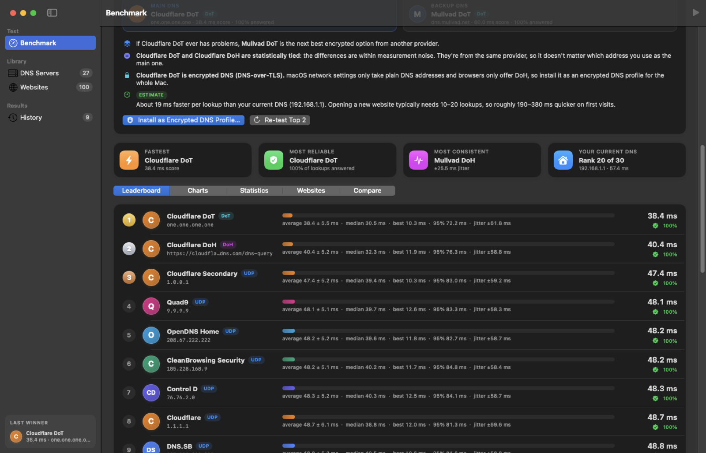
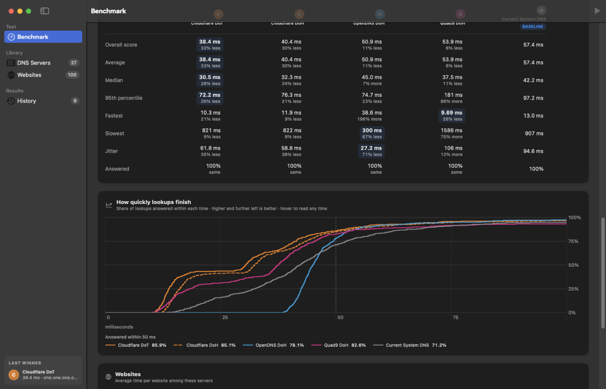

<p align="center">
  
</p>

<h1 align="center">DNS Pulse</h1>

<p align="center">
  <b>Find the fastest DNS for your Mac, and know whether the difference is real.</b><br>
  A native macOS app in Swift and SwiftUI that races DNS providers against each other over plain DNS,
  DNS-over-TLS and DNS-over-HTTPS, then tells you what to switch to.
</p>

<p align="center">
  <a href="https://github.com/zivkogodzirov/DNSPulse/releases/latest"></a>
  
  
  
  <a href="LICENSE"></a>
</p>

<p align="center">
  
</p>

## Download

1. Download **DNS-Pulse-1.0.0.dmg** from the [latest release](https://github.com/zivkogodzirov/DNSPulse/releases/latest).
2. Open it and drag **DNS Pulse** into **Applications**.
3. Open DNS Pulse from Applications.

Requires macOS 14 Sonoma or later, on Apple silicon or Intel.

<details>
<summary><b>macOS says it can't verify DNS Pulse?</b></summary>

DNS Pulse isn't notarised by Apple yet, so macOS asks you to confirm the first time you open it:

- **macOS 15 or later:** open the app once and click **Done**, then go to **System Settings › Privacy & Security**,
  scroll down and click **Open Anyway** next to DNS Pulse, and confirm.
- **macOS 14:** right-click DNS Pulse in Applications, choose **Open**, then click **Open**.

You only need to do this once. Or, in Terminal:

```bash
xattr -dr com.apple.quarantine "/Applications/DNS Pulse.app"
```
</details>

## Why DNS Pulse

- **Fair races.** Every website is looked up on every server at the same moment, so all servers see the same network conditions.
- **Honest answers.** Differences come with 95% confidence ranges, and statistical tests separate a real winner from
  measurement noise. When two servers can't be told apart, DNS Pulse says so instead of crowning one.
- **It notices when your network cheats.** Many routers and ISPs answer all plain DNS themselves, whatever server you ask.
  DNS Pulse detects this and shows which resolver really answers you.
- **Encrypted DNS built in.** Test DNS-over-TLS and DNS-over-HTTPS side by side with plain DNS, then install the winner
  as an encrypted DNS profile for the whole Mac.

## Features

### Testing
- **48 built-in servers:** Cloudflare, Google, Quad9, OpenDNS, AdGuard, Control D, Mullvad, CleanBrowsing, DNS4EU,
  NextDNS and more, over plain DNS, **DNS-over-TLS** and **DNS-over-HTTPS**, plus your current system DNS.
- **100 popular websites** built in. Add your own, import from a file, or import your most-visited sites from your
  browser history (read locally; nothing leaves your Mac).
- **Three test modes:**
  - *Real-world* looks websites up the way a browser does.
  - *Cached* primes every resolver first, so it measures pure response time.
  - *Uncached* adds a random sub-domain to force a full recursive lookup.
- Record types A, AAAA, HTTPS, MX, TXT and NS. Rounds, timeout, parallel lookups and ordering are all adjustable.

### Results
- **Live leaderboard** with an overall score, average, median, 95th percentile, jitter and answer rate.
- **Winner banner and "What you should do"** panel: a main and backup DNS, caveats, and an estimated real-world saving.
- **Compare** up to five servers against a baseline, with a verdict for each: *clearly faster*, *clearly slower* or
  *no real difference*, plus how they did against each other across your saved tests.
- **Website Times grid:** every website × every server, colour-coded on a log scale.
- **Charts:** score, consistency range, per-round trend and reliability.
- **Retest failed lookups** to rule out a passing Wi-Fi dropout, and **re-test the leaders** with more rounds.

<p align="center">
  
  
</p>
<p align="center">
  
  
</p>

### Acting on the results
- **Use This DNS** switches your Mac to the winner plus a backup from another provider, with one password prompt.
  **Restore Previous DNS** undoes it.
- **Encrypted DNS profile:** save a DoT or DoH winner as a `.mobileconfig` profile for your Mac or iPhone, with
  step-by-step install and removal help.

### Network insight
- **Interception detection:** a lookup sent to a reserved address where no server can exist. If it's answered,
  something on your network is answering all plain DNS itself.
- **Your real resolver by name:** the resolver your Mac ends up using, which can differ from the address in its settings.
- **Diagnose** any server: which operator and city answered, and whether lookups are forwarded or intercepted.
- **Networks and history:** every test is tagged with the network it ran on, so you can compare home and work.
  Optional scheduled checks can notify you when your DNS gets slow or starts failing.

## How it works

| | |
|---|---|
| **Plain DNS** | A connected UDP socket sends a standard query with EDNS(0). The clock runs from just before `send()` to the matching response ID. |
| **DNS-over-TLS** | RFC 7858 over a small pool of TLS connections per server, opened during warm-up, so the timing covers the lookup, not the handshake. |
| **DNS-over-HTTPS** | RFC 8484 POST over one reused HTTPS connection per provider, also warmed up first. |
| **Score** | The average response time with each failed lookup counted as a full timeout, so a fast but flaky server can't win. Failures are pooled across servers unless a server fails significantly more often than the rest. |
| **Ties** | Welch's t-test for averages, Fisher's exact test for failure rates, and distribution-free order-statistic intervals for the median and 95th percentile. |
| **Uncached mode** | If a server refuses a made-up name but answers the real website, that lookup is left out rather than counted against it. |

## Privacy

DNS Pulse has no accounts, analytics or tracking. Your tests, settings and history stay on your Mac in
`~/Library/Application Support/DNS Pulse/`. The only network traffic is DNS lookups: to the servers you test, to
`dnscheck.tools` to name your resolver, and to Google, Cloudflare and Akamai's "who am I" names when you diagnose a server.

## Build from source

Requires macOS 14 or later and Xcode 15.3 or later (Swift 5.10).

```bash
git clone https://github.com/zivkogodzirov/DNSPulse.git
cd DNSPulse
./build_app.sh              # builds "build/DNS Pulse.app" for Apple silicon and Intel
open "build/DNS Pulse.app"
```

- `ARCHS=arm64 ./build_app.sh` builds for Apple silicon only, which is faster.
- `./scripts/make_dmg.sh` packs the app into `build/DNS-Pulse-<version>.dmg`.
- Open `Package.swift` in Xcode to work on the code.

### Command line

```bash
"build/DNS Pulse.app/Contents/MacOS/DNSPulse" --cli --rounds 3 --sites 25 --mode cached
```

Options: `--rounds N`, `--sites N`, `--mode real|cached|uncached`, and `--all` to include servers that are switched off.
It uses the servers and websites you set up in the app.

### Project layout

```
Sources/DNSPulse/
  App/        entry point, menus, command-line mode
  Engine/     DNS packets, UDP/DoT/DoH probing, interception check, benchmark runner
  Models/     servers, websites, settings, results, comparison, persistence
  Views/      SwiftUI screens and components
  Support/    statistics, formatting, profiles, import and export
scripts/      icon rendering and disk image packaging
```

`scripts/render_icon.swift` draws the icon with Core Graphics, and `scripts/make_icons.sh` turns it into
`Resources/AppIcon.icns` and a layered Liquid Glass `Resources/Assets.car` for macOS 26.

## Licence

DNS Pulse is released under the [MIT licence](LICENSE).
